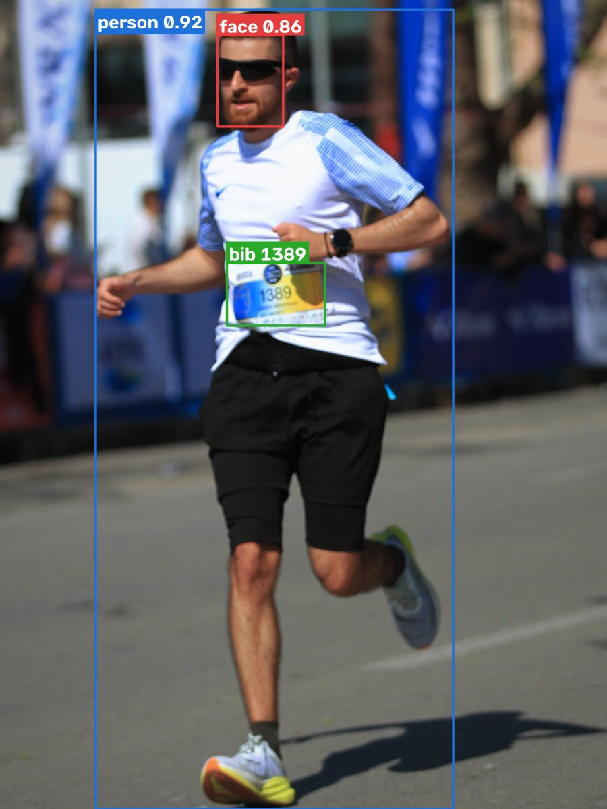

# Race Photo Finder

Race Photo Finder organizes event photographs by participant and lets runners
find their photos using a bib number.

It is more than a bib detector. The first pass reads visible bibs and uses them
to build reliable participant identities. It also extracts face embeddings.
After all photos are processed, conservative face matching can recover
additional photos where a bib is hidden, turned away, blurred, or outside the
frame.

```text
photo → person detection → bib recognition + face embedding → participant match
```

<p align="center">
  
  <br>
  <sub>Real pipeline output: <b>person</b> detection (blue), <b>face</b> detection (red), and <b>bib</b> detection with OCR reading "1389" (green).</sub>
</p>

The importer builds each participant's face template only from photos where the
bib was recognized. It then associates sufficiently confident unmatched faces
with that participant. Search combines bib-confirmed and face-matched photos in
one gallery. Face-derived matches never feed back into the templates, which
prevents one uncertain match from influencing later matches.

## Quick start

### 1. Clone the repository with its models

The person detector, bib detector, and OCR models are included through
[Git LFS](https://git-lfs.com). Install Git LFS before cloning:

```bash
git lfs install
git clone https://github.com/dimfot3/RacePhotoFinder.git
cd RacePhotoFinder
```

If you cloned without Git LFS, run `git lfs pull` inside the repository.

### 2. Install dependencies

```bash
python -m pip install -r requirements.txt
```

### 3. Download the face models

The InsightFace `buffalo_l` face models cannot be redistributed with this
repository. This script downloads them directly from
[InsightFace's official release](https://github.com/deepinsight/insightface/releases/tag/v0.7),
verifies their SHA-256 checksums, and puts them in place:

```bash
python setup_models.py
```

> [!IMPORTANT]
> InsightFace pretrained models are licensed for **non-commercial research
> only**. The script asks you to accept the
> [InsightFace terms](https://github.com/deepinsight/insightface#license) before
> downloading. For commercial use, contact [InsightFace](https://www.insightface.ai/)
> about a license.

To accept the terms without a prompt, for example in a script, use
`python setup_models.py --accept-license`.

### 4. Process an event

Point the importer at a folder of event photos. `--rerun` replaces any
previously processed event:

```bash
python app.py "/path/to/event/photos" --rerun
```

To attach names and finish times to bib numbers, add
`--participants-csv participants.csv`. See
[database_core/participants.example.csv](database_core/participants.example.csv)
for the format.

### 5. Search for photos

```bash
python app.py
```

Open http://127.0.0.1:5000 and search by bib number.

Original photos are never modified. The application stores its index in SQLite
and creates smaller previews for browsing.

## License

Original Race Photo Finder source code is licensed under the
[GNU Affero General Public License v3.0](LICENSE). Third-party software and
model artifacts retain their own terms; see
[THIRD_PARTY_NOTICES.md](THIRD_PARTY_NOTICES.md).
