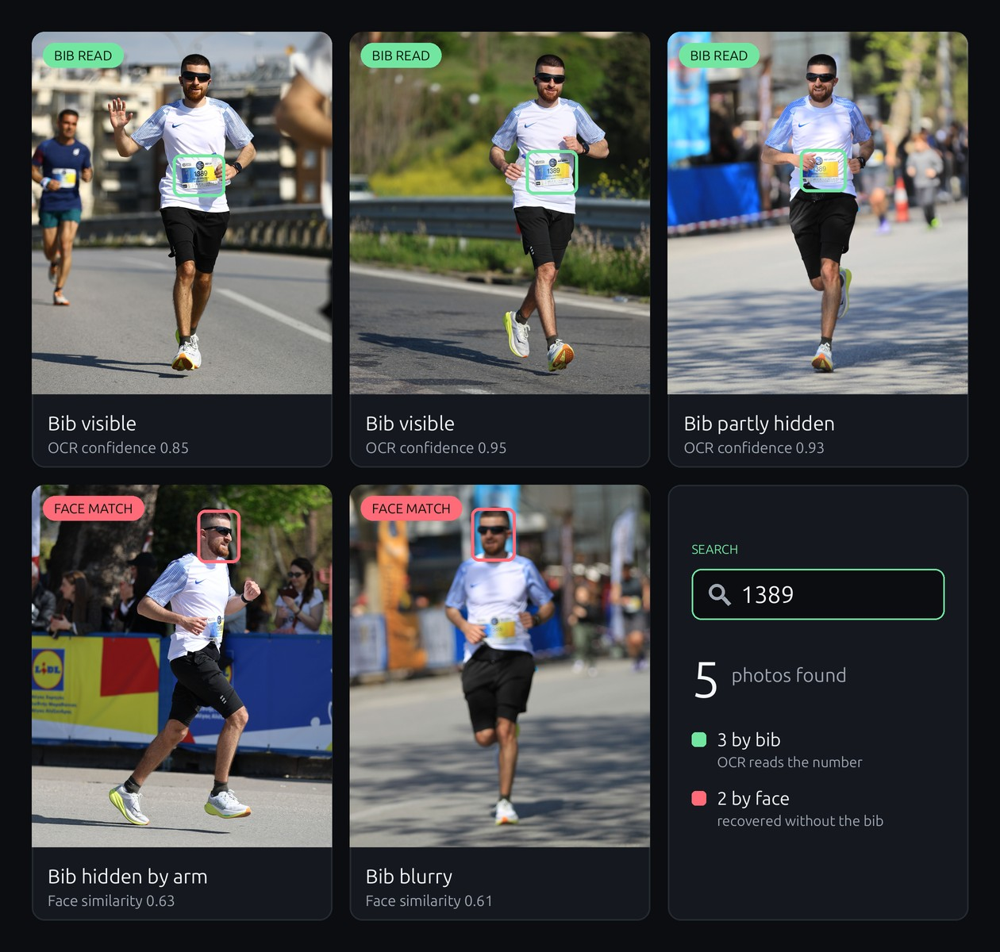

# Race Photo Finder

Race Photo Finder organizes event photographs by participant and lets runners
find their photos using a bib number.

It is more than a bib detector. The first pass reads visible bibs and uses them
to build reliable participant identities. It also extracts face embeddings.
After all photos are processed, conservative face matching can recover
additional photos where a bib is hidden, turned away, blurred, or outside the
frame.

```text
photo → person detection → bib recognition + face embedding → participant match
```

<p align="center">
  
  &nbsp;
  
  <br>
  <sub><b>Left:</b> real pipeline output: <b>person</b> (blue), <b>face</b> (red), and <b>bib</b> with OCR reading "1389" (green).
  <b>Right:</b> searching bib 1389 finds 3 photos by bib and recovers 2 more by face, where the bib is hidden or blurry.</sub>
</p>

The importer builds each participant's face template only from photos where the
bib was recognized. It then associates sufficiently confident unmatched faces
with that participant. Search combines bib-confirmed and face-matched photos in
one gallery. Face-derived matches never feed back into the templates, which
prevents one uncertain match from influencing later matches.

## Quick start

### 1. Clone the repository with its models

The trained bib detector, OCR, and face models are included through
[Git LFS](https://git-lfs.com). The COCO-pretrained RF-DETR checkpoint used for
person detection downloads automatically on first run. Install Git LFS before
cloning:

```bash
git lfs install
git clone https://github.com/dimfot3/RacePhotoFinder.git
cd RacePhotoFinder
```

If you cloned without Git LFS, run `git lfs pull` inside the repository.

### 2. Install dependencies

```bash
python -m pip install -r requirements.txt
```

### 3. Process an event

Each event gets its own name (lowercase letters, digits, and hyphens). Point
the importer at a folder of event photos. `--rerun` replaces any previously
processed photos of that event:

```bash
python app.py "/path/to/event/photos" --event athens-marathon-2026 --rerun
```

To process an event without face matching (no face data is stored, and
search shows bib matches only), add `--no-face-matching`. The choice is saved
in the event's settings, so later imports of that event follow it too.

To attach names and finish times to bib numbers, add
`--participants-csv participants.csv`. See
[database_core/participants.example.csv](database_core/participants.example.csv)
for the format.

Every event is stored in its own folder, `data/events/<event>/`, holding its
SQLite database, thumbnails, and an `event.yaml` with its settings:

```yaml
name: Athens Marathon 2026
date: 2026-11-08
published: false      # search shows the event only once this is true
face_matching: true   # false: no face data is stored for this event
```

### 4. Search for photos

```bash
python app.py --show-unpublished
```

Open http://127.0.0.1:5000, choose the event, and search by bib number.
`--show-unpublished` lets you review an event before setting
`published: true`.

To permanently remove an event's data (original photos are not touched):

```bash
python app.py --event athens-marathon-2026 --delete-event
```

Original photos are never modified. The application stores its index in SQLite
and creates smaller previews for browsing.

## License

Original Race Photo Finder source code is licensed under the
[GNU Affero General Public License v3.0](LICENSE). Third-party software and
model artifacts retain their own terms; see
[THIRD_PARTY_NOTICES.md](THIRD_PARTY_NOTICES.md).
